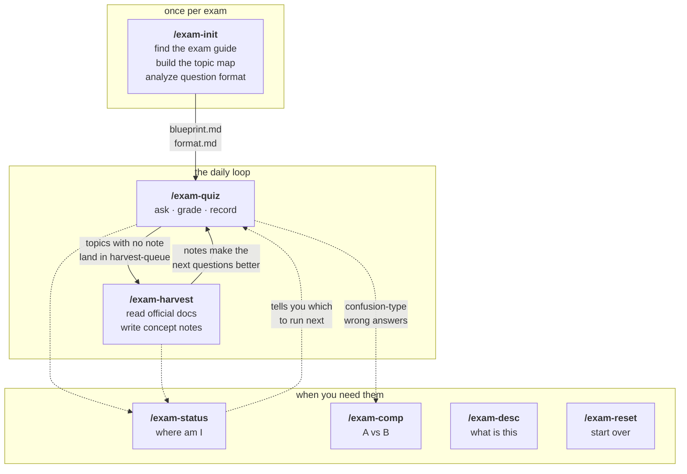
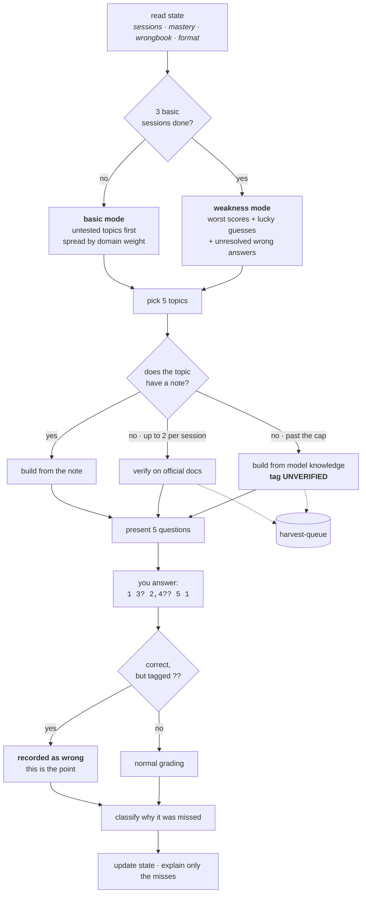
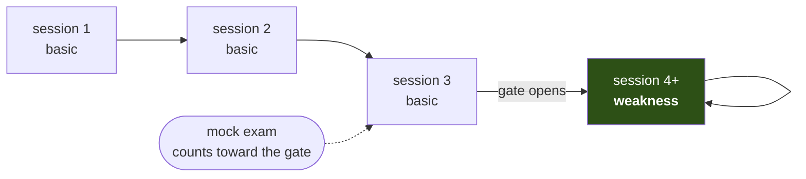
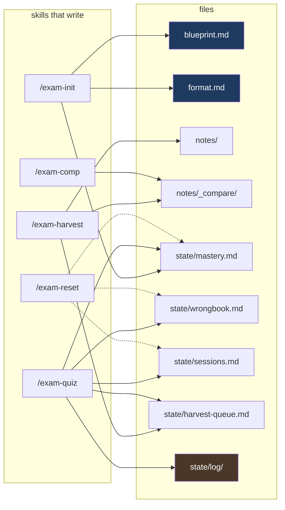

# weakness-manager

> The dangerous part of studying for a certification isn't the questions you got wrong.
> It's the areas you never ran into at all. This repo exists to find those and eliminate them.

A certification study system built from seven Claude Code skills and a pile of markdown files.
No database, no server, no app. Everything is a `.md`.

---

## What's different

Most quiz apps track **accuracy**. But accuracy is computed only over the questions already asked,
so untouched territory never shows up in the statistics. And on a 4- or 5-option question,
elimination gets you a fair number of correct answers you didn't actually know.

This system looks at the blind spot through three layers.

| Layer | Mechanism | What it catches |
|---|---|---|
| 1 | **Coverage map** — the official exam scope expanded to leaf topics, with ⬜ untested tracked | Areas never asked about |
| 2 | **Confidence tags** — a lucky guess counts as wrong | Ignorance hidden by luck |
| 3 | **Error type classification** — five reasons you got it wrong | Mistakes that need different treatment |

---

## How the pieces fit

Seven skills. Two of them are the loop you actually live in; the rest are there when you need them.



**The loop is self-feeding.** Every question asked about a topic with no note queues that topic.
Harvest drains the queue into notes. The next question on that topic comes from the note instead of the web.
Quiz gets faster and more accurate the more you use it.

### What a single session does



## Getting started

### 1. Register an exam

```
/exam-init AWS SAP
```

Finds the official Exam Guide, extracts domains and their weights, and breaks them down to leaf topics
to build your study map (`blueprint.md`). It also analyzes official sample questions to produce a
**question format spec** (`format.md`) — how many options, how much of the exam is multiple-response,
how long the stems run.

Mention your exam date if you have one and a D-day gets tracked.

### 2. Answer questions

```
/exam-quiz
```

Five questions at once. Answer on one line:

```
1 3? 2 5?? 4
```

### 3. Fill in the knowledge

```
/exam-harvest 3
```

As you take quizzes, topics that had no notes and were asked provisionally pile up in a queue.
Harvest reads vendor official documentation and turns them into proper notes. Three topics takes about two minutes.

Those three commands are the loop. Everything else is there when you need it.

---

## Supplying your own sources

**Any exam, any time.** Whatever you have — an official exam guide, a textbook, lecture notes, a past-paper
collection, a page you photographed — hand it over and it gets used. This is not only for exams with poor web coverage;
your own material always outranks what a search turns up.

### Accepted source types

| Type | Notes |
|---|---|
| **Web (URL)** | Hand over a link and it gets fetched |
| **PDF** | Best option for structured documents |
| **MD · TXT** | |
| **DOCX** | Word documents |
| **XLSX** | Spreadsheets |
| **PPTX** | Lecture slides |
| **Images** (PNG · JPG) | A phone photo of a textbook page works |
| ~~HWP~~ | **Not readable** — export as PDF from 한글 first. Automatic conversion mangles the tables that carry the structure |

### Three ways to hand something over

**1. Drop it in `_inbox/`** — before registering an exam is fine; so is adding more later

```
_inbox/
├── AWS_SAP_exam_guide.pdf
├── 유통관리사_출제기준.pdf
└── 상권분석_강의노트.md
```

**2. Name a path or a URL**

```
/exam-init 유통관리사 2급  ~/Downloads/출제기준.pdf
/exam-harvest  https://docs.aws.amazon.com/...
```

**3. Attach or paste it into the conversation** — anything substantial gets saved to `exams/{slug}/_sources/`
so it survives the session and can be reused later

Everything ends up in `exams/{slug}/_sources/`. Originals in `_inbox/` are never deleted.

### Which skill uses what

| Material | Skill | Goes into |
|---|---|---|
| Exam guide · 출제기준 | `/exam-init` | `blueprint.md` — domains and topics |
| Past papers · sample questions | `/exam-init` (Phase 4) | `format.md` — question format only, no original text stored |
| Textbook · lecture notes · docs | `/exam-harvest` | `notes/` — concept notes |
| Exam announcement | `/exam-init` | `exam.md` — question count, duration, passing score |

If you add an exam guide **after** registration, run `/exam-init --refine` (blueprint) or `/exam-init --format`
(question format) — harvest only writes notes.

Where this matters most is exams with thin web coverage. AWS and CNCF publish everything online, but Korean
certifications distribute their 출제기준 as HWP and do not release past papers for CBT sittings.
With the 출제기준 in hand the blueprint comes out cleaner than a vendor exam's —
`주요항목 → 세세항목` maps straight onto domains and leaf topics.

See [_inbox/README.md](_inbox/README.md) for details.

## Answer syntax

The number of question marks is how unsure you are.

| Input | Meaning |
|---|---|
| `2` | Confident — I knew it |
| `2?` | Shaky — narrowed it to two |
| `2??` | Guessed — I basically don't know |
| `2,4` | Multiple response (Choose TWO) |
| `2,4??` | Multiple response, guessed |

**A question answered `??` is recorded as wrong even when the answer is correct.**
The more honestly you attach question marks, the more accurate the system gets.
Plain `2` every time works fine, but that switches off one of the three layers.

---

## Commands

| Command | What it does |
|---|---|
| `/exam-quiz` | Take questions. Mode is decided automatically by session count |
| `/exam-quiz 10문제` | Set the number of questions |
| `/exam-quiz D2` | One domain only |
| `/exam-quiz 모의고사 30` | Mock exam. Batch grading plus a per-domain score table |
| `/exam-status` | Current state on one screen — coverage, weak spots, D-day, what to do next |
| `/exam-harvest` | Turn queued topics into notes |
| `/exam-harvest D2` | By domain |
| `/exam-comp SCP vs IAM policy` | Build or show a comparison table |
| `/exam-comp 하이브리드 연결` | Three or more options becomes a decision guide |
| `/exam-comp` | No argument → list the wrong answers that need comparison tables |
| `/exam-desc Transit Gateway` | Explain a concept from your notes |
| `/exam-desc 상권분석` | Explain a whole domain — what it covers and how it is weighted |
| `/exam-init 자격증명` | Register a new exam |
| `/exam-init --format` | Refresh the question format spec |
| `/exam-reset` | Reset state (after backup) |

---

## Study modes



The first three sessions are locked to **basic mode**.

Weakness mode only means something once weaknesses have surfaced, and one or two sessions is too small a sample.
So until three basic-mode sessions (diagnostic or mock) are done, asking for weakness mode still runs basic mode.
Basic mode prioritizes untested (⬜) topics, so three rounds pull the blind spots to the surface.

| Mode | When | Difficulty mix |
|---|---|---|
| Basic (diagnostic) | Sessions 1-3 | easy 40 / med 40 / hard 20 |
| Weakness | Session 4 onward | med 30 / hard 70 |
| Section | When you name a domain | That domain |
| Mock exam | On request | Real exam weights |

---

## Error types

Different reasons for a wrong answer need different treatment.

| Type | Meaning | Automatic treatment |
|---|---|---|
| Unknown | Concept you simply don't know | Queued for harvest |
| Confusion | Mixing up two similar things | Comparison table candidate |
| Misread | Missed the requirement keyword | Missed keyword logged and counted |
| Distractor | Fell for a plausible wrong option | Distractor pattern accumulated |
| Recall | Knew the concept, got the number wrong | Card added to `_facts.md` |

On an exam like AWS SAP, where `MOST cost-effective` and `LEAST operational overhead` decide the answer,
**misread costs more points than genuine ignorance does.** So it gets counted separately.

---

## Storage layout

```
exams/aws-sap/
├── exam.md          Exam metadata (code, question count, time, passing score, D-day)
├── format.md        Question format spec + format anchors
├── blueprint.md     Domains, weights, topic tree (immutable spec)
├── notes/           Concept notes, comparison tables, fact cards
└── state/           Proficiency, wrong answers, session log, harvest queue
```

Each exam gets its own complete set. A wrong answer on AWS SAP has no effect on CKA.

### Who writes what



Blue = written once and treated as immutable afterwards. Brown = write-only; nothing ever reads it back.
`/exam-reset` is dashed because it only ever writes after copying the originals into `_archive/`.

Three rules hold this together:

- **`blueprint.md` is written once and never again** — coverage and accuracy live in `mastery.md`, so quiz never
  touches the spec
- **`format.md` changes only through `/exam-init --format`** — harvest may observe a change but never apply one
- **`state/log/` is write-only** — quiz appends the full question text there and never reads it back,
  which is what keeps session cost flat no matter how long you study

---

## Multiple exams

```
/exam-init Claude Certified Associate
/exam-quiz aws-sap            ← name an exam
/exam-status                  ← overall view
```

`exams/_active.md` remembers the current exam, so you normally don't need to name one.

---

## Things to know

- **Don't work the same exam from two sessions at once.** Last write to the state files wins. (No lock — single-user assumption.)
- **Without notes, question quality drops.** When you keep seeing `[UNVERIFIED]` tags, it's time to run harvest.
- **Sources are tiered by artifact, not by site.** Official docs, statutes and statistics, your own files, and
  **past questions with their answer keys** can back a note. **Community-written explanations cannot** — those are
  used only for format analysis. The same past-paper page counts as both, depending on which part is being used.
- **You'll be told when the exam changes.** If harvest spots a format change while reading official docs, it records it.
  Topic IDs are never reissued, so your accumulated history survives a reorganization.

---

## Other agents

The skills follow the [Agent Skills](https://agentskills.me) open format and live in `.agents/skills/`, which
Codex and Gemini CLI both read directly. `.claude/skills` is a symlink to the same directory, and `AGENTS.md`
and `GEMINI.md` are symlinks to `CLAUDE.md` — one copy of everything, three tools.

| | Skills read from | Project instructions | Invoke |
|---|---|---|---|
| Claude Code | `.claude/skills/` → link | `CLAUDE.md` | `/exam-quiz`, or just ask |
| Codex | `.agents/skills/` | `AGENTS.md` → link | `$` prefix or `/skills`, or just ask |
| Gemini CLI | `.agents/skills/` | `GEMINI.md` → link | `activate_skill`, or just ask |

All three do implicit activation from the skill description, so plain language ("문제 내줘") works everywhere.

Two things differ outside Claude Code: harvest's parallel collection falls back to sequential where subagents
aren't available (same notes, roughly 3x the wall time), and tool names in the skill bodies are written in
Claude Code's vocabulary — `Read(limit=15)` means "read only the first 15 lines," which other agents infer
but do not execute identically.

## Documents

| | |
|---|---|
| `CLAUDE.md` | Agent operating rules (auto-loaded every session) |
| `docs/DESIGN.md` | Design rationale, token budget, migration rules |
| `_spec/error-taxonomy.md` | How the five error types are decided |
