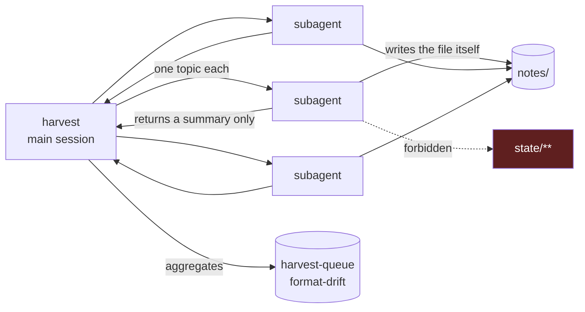
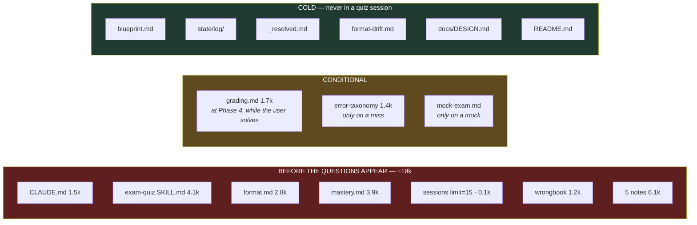
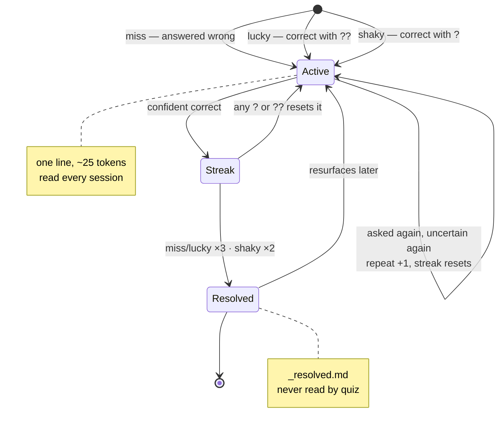
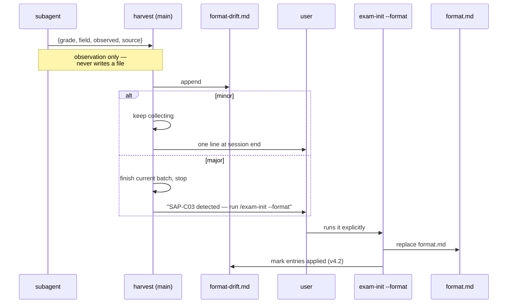

# Design notes

Read this before modifying a skill or a state file format. Every decision here has a reason, and most of them involve tokens.

---

## 1. What problem this solves

The problem is not "review the questions you got wrong." It is **discovering the areas you never encountered.**

Accuracy-based tracking structurally cannot do this, because accuracy is computed only over the population already asked.
On top of that, 4- and 5-option questions reward elimination, so a fair share of unknown material comes out correct.
Hence three layers.

| Layer | Mechanism | Where it lives |
|---|---|---|
| 1 | Coverage map (⬜ untested tracking) | topic expansion in `blueprint.md` + coverage in `mastery.md` |
| 2 | Confidence tags — any hesitation enters the review queue | answer parsing in `exam-quiz` · `mastery.lucky` · `wrongbook.origin` |
| 3 | Error type classification | `_spec/error-taxonomy.md` |

Layer 2 is the experimental hypothesis of this system, and it does two separate jobs.

**Scoring**: `??` counts as wrong. That splits surface accuracy (say 62%) from real accuracy (say 48%),
and the gap is the size of the blind spot.

**Queueing**: `?` *and* `??` both enter the wrongbook, regardless of whether the answer was right.
The queue asks "would I get this again without hesitating?", which is a lower bar than "did I get it right"
and a different question from "do I know it." Conflating the two would either punish the score for
answers that were genuinely correct, or let hesitation go untracked. It does neither.

---

## 1-1. Skill and file responsibility map

Before changing any skill, check this. Most bugs in this system come from a skill writing a file it does not own.

```
                    READ                              WRITE
                    ────────────────────────────      ────────────────────────────
exam-init           _inbox/ · _sources/ · web         blueprint · format · exam
                    _template/                        mastery (init) · _active · _registry

exam-harvest        _inbox/ · _sources/ · web         notes/ · notes/_compare/ · _facts
  └─ subagent       harvest-policy.md · official      the one note file  ← only this
                    docs                              (never anything under state/)
                    format.md (limit=14)              harvest-queue · format-drift
                                                      _registry (own row)

exam-quiz           _active · sessions (limit=15)     mastery · wrongbook · _resolved
                    mastery · wrongbook · format      sessions · harvest-queue · log/
                    notes/{5 topics} · web            _active (on switch) · _registry (own row)
                    grading.md (at Phase 4)
                    error-taxonomy (only on a miss)
                    never _spec/source-policy.md

exam-status         _registry  ·  or the full set     nothing   (--rebuild is the one exception)
                    for the active exam

exam-comp           wrongbook · notes/ · web          notes/_compare/ · wrongbook (notes column)

exam-desc           grep notes/ · mastery row         nothing   (harvest-queue only if the user agrees)

exam-reset          reset-scope.md                    state/*  after copying to _archive/
                                                      --rm: moves exams/{slug}/ to exams/_archive/
```

### Ownership rules these encode

| File | Sole writer | Why it matters |
|---|---|---|
| `blueprint.md` | `exam-init` | Immutable spec. If quiz could write it, coverage and definition would drift apart |
| `format.md` | `exam-init --format` | Harvest sees drift first but must not act on it — parallel subagents would corrupt it |
| `state/log/` | `exam-quiz` (append) | Write-only. The moment anything reads it, session cost starts growing with history |
| `notes/**` | `exam-harvest`, `exam-comp` | Quiz consumes notes; it never produces them, so questions stay freshly generated |
| `mastery.md` | `exam-quiz` | Proficiency changes only by being tested. Reading a note does not make you better at it |

### Subagent boundary



The summary a subagent returns is `{topic id, file path, source count, one line, drift observations}` — never prose.

Two separate reasons for this shape, and both matter:

1. **Context isolation** — a subagent returning note bodies would put 6k of prose back into the main context,
   defeating the entire point of fanning out
2. **Write safety** — several subagents editing `harvest-queue.md` at once corrupts it. Only the main session aggregates

## 2. There is exactly one hot path

Of the eight skills, only `exam-quiz` runs at high frequency (1-3 times a day, on a phone). The rest are rare and are not
optimization targets. **Every optimization argument is settled by asking: does this affect per-session cost of quiz?**



**Anything moved from COLD to HOT has to justify itself in tokens per session, every session, forever.**
That is the test a new feature has to pass.

### Per-session token budget — measured 2026-08-18

Two numbers matter, not one. What loads **before the questions appear** is what the user waits through;
what loads after lands in the window they spend solving.

| Before the questions appear | |
|---|---|
| CLAUDE.md | 1.5k |
| exam-quiz SKILL.md (generation rules merged in) | 4.1k |
| format.md | 2.6k - 2.8k |
| mastery.md | 3.4k - 3.9k |
| sessions.md via `Read(limit=15)` | 0.1k |
| wrongbook.md (active only) | ~1.2k projected |
| 5 notes | **~6.1k measured** (1.2k each; target 800-1,500) |
| **Subtotal** | **~19k** |

| After the questions are out — free window | |
|---|---|
| `references/grading.md` at Phase 4 | 1.7k |
| `_spec/error-taxonomy.md`, only on a miss | 1.4k |

Earlier revisions claimed ~9-10k, then ~16-17k. Each was corrected upward as something got measured rather than
estimated. The largest remaining item is **notes**: the 28 written so far average **1,217**, so five of them
cost 6.1k rather than the 3.0k an early estimate assumed.

### Note size — the target is 800-1,500, set from both ends

The original 400-700 was written before any note existed. Every note actually produced landed above it, which
usually means the target was wrong rather than the work. The range now has a reason at each end.

| | Cost per session (×5) | Questions before it runs dry |
|---|---|---|
| 600 tokens | 3.0k | 2-3 |
| **800 — lower bound** | 4.0k | 3-4 |
| **1,500 — upper bound** | 7.5k | 6-7 |
| 2,000 tokens | 10.0k | 7-8 |

**Below 800** the note is spent after two or three questions and the topic keeps returning to the queue —
you pay the collection cost repeatedly instead of once.

**Above 1,500** the cost lands on every session, five times over, buying depth that most topics never use.
Most are asked once or twice in a study period; only the stubborn few exhaust a note at all.

That asymmetry is why the answer to exhaustion is not "write thicker notes." It is to keep them in range and
deepen the specific ones that earn it, which is what the `exhausted` queue reason does.

Splitting grading out moved 1.7k off the clock without removing anything.

**No change may introduce a read that grows with session count.** That is still the one hard rule.

### The two heavy items, and whether they are justified

- **`format.md` at 2.8k** — the weight is the two synthetic anchors, each a full exam-length scenario with options.
  Trimming them is the obvious saving and the wrong one: prose spec alone does not fix the tone, which is the entire
  reason anchors exist. Cap anchor length at the exam's own stem-word range rather than cutting one.
- **`mastery.md` at 3.9k** — this one is genuinely open. See below.

---

## 3. Preventing unbounded growth

### The wrong-answer lifecycle

This is the state machine that keeps the hot path flat. Everything expensive drains into a file nobody reads.



Three origins enter the same queue but carry different weight. `lucky` is scored as a wrong answer because a guess
that landed is not knowledge. `shaky` is scored as **correct** — it was correct — yet still queued, because
narrowing to two and winning the coin flip is not the same as knowing. Only the review queue treats them alike;
the score does not.

`shaky` retires after two confident answers rather than three. The evidence of not-knowing is weaker, and holding
it to the same bar would inflate the one file quiz reads on every single session.

Full question text goes to `state/log/{YYYY-MM}.md` at the moment of grading and is never read **in the loop**.
That single decision is what separates a constant-cost system from one that gets slower every week.
(`exam-desc` can retrieve one entry on request — see below.)

### wrongbook split three ways

An AWS SAP stem runs 100-150 words. Storing a wrong answer with full question text, options, and explanation costs about
450 tokens. A hundred of those is 45k — you would be reading 45k to get five questions.

```
state/wrongbook.md      Active wrong-answer index (one line ≈ 25 tokens) — quiz reads this
state/_resolved.md      Retired entries — quiz does not read it
state/log/{YYYY-MM}.md  Full question text and per-option verdicts — quiz never reads it
```

Active entries leave the index when resolved, so the realistic ceiling is 30-60 entries.

### The log is archival, not sealed

"Write-only" is a rule about the **loop**, not a prohibition. What must never happen is a per-session read that
grows with history. A one-off lookup the user explicitly asked for costs nothing per session.

So `exam-desc` may open the log for a named entry. Two things make that safe:

- **Log headings carry the wrongbook ID** — `### Q3 — W-001 · T-034 · …`. quiz already knows the ID when it
  writes the row, so the anchor is free. Lookup becomes `grep -n` plus a 40-line window: an index hit, not a scan
- **Reading a log file without an offset and a limit is forbidden**, in the skill and here

Why bother: the wrongbook's one-line core answers "what concept did I get wrong," which is usually enough.
It cannot answer "what did the question actually say" — and for `misread` errors, the wording of the stem
*is* the lesson. That is the case this path exists for.

### Hot block on top + `Read(limit=N)`

Mode gating needs exactly one number from `sessions.md`: how many basic-mode sessions are done.
Put the aggregates in the top four lines and cut the read at `Read(limit=15)` so the log is never loaded.

Apply this to every state file. **When designing a file, first ask whether the hot path's values sit in the first 15 lines.**

### Mock exam batching

Generating 65 questions in one context costs 13k output plus 39k input, and later questions visibly degrade.
Split into batches of 10 and carry only `{correct count, per-domain score}` across batches. Discard earlier stems.

---

## 4. Optimizations deliberately skipped

Over-optimizing only adds consistency risk. These were considered and **intentionally not done**.

| Item | Why not |
|---|---|
| ~~TOP-N cache in `mastery.md`~~ | **Reopened — the premise was wrong.** This was rejected on an estimate of 1.4k. The measured figure is **3.9k**, about a quarter of the whole session. See "Open question" below |
| Batching the per-session Edit calls | Ten of them total ~300 tokens. An append-only log would cost more in re-aggregation |
| Removing `_template/` | One `cp -r _template/exam exams/{slug}` creates six files **without reading the template**. It saves tokens |
| Session lock | Single user. Instead quiz warns if `sessions.md` was modified within 5 minutes |
| git / scheduled reminders / push | User decided against them. Add later if needed |

### Open question — a hot block for `mastery.md`

At 3.9k it is the single largest runtime read, and quiz does not actually need all of it:

- **Weakness mode** needs the top ~15 rows by score, to choose 5
- **Basic mode** needs the ⬜ list and the per-domain counts
- Everything else in the table is only touched at write time

A hot block carrying the top-20 by score plus per-domain ⬜ counts would be roughly 0.4k, saving ~3.5k —
about 22% of the session. The cost is the usual one: derived data can drift from the table it summarizes.

Unlike the version of this decision recorded above, the saving is now large enough to be worth the drift risk.
Not implemented; decide before the note corpus grows, because quiz's write path changes with it.

---

## 5. Topic IDs — the one thing that cannot be repaired

**Format `T-041`. Sequential. The domain is not encoded.**

The first draft used `T-D2-07` with a domain prefix. When domains are reorganized, the prefix and the actual
membership diverge. Fixing the prefix breaks the join key in `mastery.md` and destroys the accumulated history.
So the ID is a meaningless serial number and the domain lives in its own column.

### Migration rules when the exam is reorganized

```
Domain reorganized  → keep the ID, change only the domain column in blueprint
Topic removed       → status: deprecated (never delete the row; history is preserved, only questions are excluded)
Topic added         → issue a new ID from topic_id_next (never roll the counter back)
Weights changed     → blueprint only; mastery is unaffected
```

Rolling back `topic_id_next` in `blueprint.md` gives two different topics the same ID. Never do it.

---

## 5-1. Not every exam has domains

The first draft assumed a vendor-style structure: named domains with published percentages. That assumption
was baked into topic selection, harvest priority, the notes directory, and the blueprint schema — and it breaks
on exams that simply do not work that way.

`blueprint.md` now records what the exam actually is:

| `structure` | Shape | Weight from |
|---|---|---|
| `weighted` | Named domains with published percentages — AWS, most vendor exams | the published % |
| `counted` | Subjects with a fixed question count each — Korean national certifications | count ÷ total |
| `flat` | One curriculum, no grouping | nothing; every topic is equal |

`section_label` holds the exam's own word for the grouping — `domain`, `과목`, `area`. The system says *section*
internally; the label is what the user sees.

**`flat` is a legitimate finding, not a failed search.** Forcing a structure onto an exam that has none invents
weights, and invented weights distort every allocation downstream — question spread, harvest priority, coverage
reporting. Discovering the real shape is the reason init's Phase 2 exists.

What falls back under `flat`: notes go to `notes/{topic}.md` instead of `notes/{section}/{topic}.md`, the
mastery section column stays empty, and question spread uses topic-ID distance instead of section share.

Deeper hierarchies flatten. A three-level 출제기준 maps 주요항목 → section and 세세항목 → topic, and the middle
level is dropped: useful while breaking topics down, noise once they exist.

## 6. format.md — compress the samples and keep them resident

Format differs between exams from the same vendor. AWS SAA is mostly single-select; SAP has a distinctly higher share of
multiple-response. Without knowing the format you keep producing questions that look plausible but don't match the real
exam, and no amount of practice on those prepares you.

Keeping the original samples resident is expensive. So **discard the content and extract only the format.**

| | Reuse value | Handling |
|---|---|---|
| Content (which service is the answer) | Low — that question won't be asked again | Read once during init, then discarded |
| Format (type mix, stem length, phrasing, distractors, difficulty) | High — applies to every question | Compressed into `format.md`, resident |

### Anchors are synthesized, not copied

Prose spec alone doesn't fix the tone, so two few-shot anchors are kept. But official sample text is never pasted in.

- It avoids the copyright question
- Pasting originals biases the model toward those topics

init reads the samples and **writes fresh examples in the same format on different subjects.**
Anchors are fixed to different domains and different types (one single-select, one multiple-response).

### Difficulty belongs to the exam

init classifies samples by reasoning depth and writes a compact E/M/H rubric plus per-mode ratios to `format.md`.
quiz owns no global difficulty definition. Multiple-response is a response format, never difficulty evidence; hard
requires multi-step judgment with competing viable designs and conflicting requirements. Missing difficulty metadata
is a format migration error, not permission for quiz to invent a fallback.

### Performance-exam switch

CKA/CKAD are hands-on, not multiple choice. `format_type: mcq | performance` marks the branch point.
Under `performance`, quiz renders "write the command / write the manifest" and grades against a reference answer.
Only the switch exists today; there is no implementation. It is there so adding K8s doesn't require restructuring the skills.

---

## 7. Format drift

Vendors revise exams (SAP-C02 → C03, curriculum updates). Harvest reads official docs, so it meets the change first.

### Detection

Read only the compact DRIFT-CHECK block at the top of `format.md` via `Read(limit=14)` and compare against what the web
showed. No extra web calls, about 180 tokens.

### Severity

| Grade | Condition | Action |
|---|---|---|
| minor | Wording changes, samples added, verified_at aging | Non-blocking. Append to `format-drift.md` and continue. One-line report at the end |
| major | Exam code, domain reorganization, weight change, question count or time change | Finish the current batch, then stop |

Stopping on major is not politeness — it **avoids wasted work writing notes for topics about to disappear.**

### Update path

Harvest runs subagents in parallel, so several agents editing `format.md` at once would corrupt it.
Observation and application are deliberately different actors.



### Version stamp

Each row of `sessions.md` carries `fmt:4.1`. When accuracy drops after a format change, being unable to tell
skill from format makes the data uninterpretable.

---

## 8. Mode gating

Weakness mode is meaningful only once weaknesses have surfaced. One or two sessions is too small a sample.

```
basic_done = (diagnostic + mock) sessions in sessions.md

basic_done < 3   →  run basic mode even when weakness mode is requested, and say so
                    allow one override if the user asks again
basic_done >= 3  →  weakness mode by default
```

Basic mode prioritizes ⬜ untested topics, so three rounds surface the blind spots. That is the point of the gate.

### Weakness score

```
(1 - accuracy) × 3  +  lucky_rate × 2  +  shaky_rate × 1  +  domain_weight  +  staleness
```

⬜ untested ranks first in basic mode. quiz writes the score into the `mastery.md` row after grading,
so the next session only has to sort — no full recomputation.

---

## 8-1. Latency after the answer is submitted

Measured on Codex: **2m30s** between submitting five answers and seeing the grade. The work itself was not the
problem — the ordering was.

Everything ran before the user saw anything: grade, write the full question text to the log, update mastery,
wrongbook, sessions, the harvest queue, the registry, then finally print the result. One session's log block
measured **2,174 tokens**, all of it emitted while the user stared at a spinner waiting for a score.

Three changes, in order of how much they save:

### Write the questions to the log during thinking time

The question text is known the moment the questions are presented. Writing it then costs the user nothing —
they are about to spend minutes solving. Writing it after they submit puts 2,000 tokens directly in front of the
answer they are waiting for.

Phase 3 writes the question block. Phase 5 appends a short result line. Roughly **2,000 tokens leave the
critical path** and land in time the user was spending anyway.

This costs one thing: the wrongbook ID does not exist yet at presentation time, so the log heading uses a
session-question ref (`S12-Q3`) and the `W-id` arrives on the result line below the question. Lookups therefore
read a window that starts *above* the grep match.

### Print the result before touching any file

The verdicts are what the user is waiting for. Any write placed ahead of them is dead time. Emit the graded
output as text, then write — the user reads while the files update.

### Issue the six writes in parallel

They touch six different files and none reads another's output, so sequencing them multiplies the wait for
nothing. The only thing to settle first is the `W-id`, which is a decision rather than a file read.

### Result

| | Before | After |
|---|---|---|
| Emitted before the user sees a grade | ~3,360 tokens | **~400**, streamed |
| Emitted after | — | ~890, parallel |
| Log write | post-answer, 2,174 | pre-answer, off the clock |

Nothing was removed. The same records get written; they are just no longer standing between the user and
their score.

## 8-2. Angle — one facet is not the topic

Three correct answers on a topic from the same angle is mastery of a facet. A 🟦 earned entirely through
`cost` says nothing about whether the same service is understood under `resilient`, and nothing was recording
which angle had been used.

`mastery.Angle` holds one code, the most recent. The vocabulary is per-exam and lives in `format.md` as
`angles:` — requirement keywords for a scenario-heavy paper, question types otherwise. Explicit rather than
free-form, because `cost` / `cost-effective` / `비용` drift apart and stop being comparable across sessions.

Two constraints keep it from doing harm:

- **The exam's distribution wins.** If a paper is 60% cost-framed, chasing variety trains against the real thing.
  Angle difference breaks ties inside the distribution; it never reshapes the mix
- **One code, last-used only.** Attempts per topic run 1-3, so a full histogram would cost tokens to record
  resolution nobody uses

Empty `angles:` means no constraint, which is the right behaviour for an exam whose samples showed no
consistent axis.

## 9. Question source pipeline

```
usable note       → generate from the note
no/exhausted note → Tier C lead → fresh draft → A/B verification
no Tier C hit     → model draft → A/B verification
verification fails → [UNVERIFIED]
```

Tier C supplies only tested combinations, scenario shapes, and traps. It never establishes the answer. Every capability,
limit, and trade-off that distinguishes an option is confirmed against A or B. Batch searches across topics to limit
round trips. There is no per-session verification cap; this intentionally trades some early-session latency for accuracy.

Verified questions carry no visible source label and never use `[WEB]`; the cold log records lead, verifier, and date in
an invisible comment. Failed verification remains `[UNVERIFIED]`. Queue no-note topics with the verifier URL so harvest
can create the durable note without repeating discovery.

### What may back a note, versus a question

The two hold to different bars, and the reason is storage.

| | Question | Note |
|---|---|---|
| Lifetime | generated fresh; cold archive only | stored, re-read for months |
| May draw on | C lead, **A/B-verified answer** | **A or B only** |

Tier C — `examtopics.com`, community explanations — is **a lead, never a citation**. It shows what gets tested;
confirm the claim against an A or B source and cite whatever confirmed it. A `[C]` citation never appears in a note.

Notes carry `sources: [A, B]` in frontmatter so quiz can see how far to trust one without opening the citations.

`harvest-queue.md` carries a `Source` column: whichever skill paid to find and verify a page records its URL
there, and harvest starts from it instead of searching again. quiz fills it at tier 2; comp and desc offer to,
but only when a fetch actually happened and only after asking.

---

## 10. The non-technical bottleneck, which is the real risk

**The harvest doom loop**: harvest doesn't get run → notes stay thin → unverified questions increase →
quality and speed drop → it gets run even less.

Two mitigations are baked into the skills.

1. quiz surfaces the queue backlog at session end and nudges — `"큐 7개. /exam-harvest 3 (약 2분)"`
2. harvest has a small-batch mode — `/exam-harvest 3` handles three queue entries. **Two minutes on a phone is what makes it a habit**

**init friction**: if the exam guide can't be found, registration itself is blocked.
→ Fast-start path. Rough out the domains, start, and refine later with `/exam-init --refine`.

---

## 11. Three documents, split by load frequency

`CLAUDE.md` is **auto-loaded into every session**. It rides along on every quiz run from a phone.

| File | Audience | Loaded | Constraint |
|---|---|---|---|
| `README.md` | Human | Never | Free |
| `CLAUDE.md` | Agent | Every session, automatically | **~1.5k ceiling** (measured 1,475) |
| `docs/DESIGN.md` | Agent | Only when modifying skills | Free |

Putting design rationale in CLAUDE.md would hand back every optimization recorded here.
**CLAUDE.md holds the "what"; the "why" lives in this file.**

The ceiling was originally written as ~700, which was a number invented before anything had been measured.
The file has since settled at 1,475, and every part of it is load-bearing: seven absolute rules, the routing
table, the file-role map, and write permissions. Cutting to 700 would mean dropping the file-role map (~400),
which a directory listing cannot replace because it encodes each file's *purpose*.

**1.5k is the working ceiling.** Treat a push past it as a signal to move something into a skill, not as a
budget to spend.

`AGENTS.md` is a symlink to `CLAUDE.md` — tool compatibility with no duplicated content.

---

## 12. Instruction language

All instruction files are English. The measured basis:

- Claude's tokenizer has no word markers for Hangul, Han, or emoji, so **they are always tokenized character by character**,
  with UTF-8 byte fallback for characters lacking a dedicated token. Common syllables cost 1 token; others cost up to 3.
  ([Sander Land, "On the Biology of Claude's Tokenizer"](https://tokencontributions.substack.com/p/on-the-biology-of-claudes-tokenizer))
- Measured chars-per-token: English 3.60, Chinese 0.96, Japanese 1.15.
  ([Claude Code Camp tokenizer measurements](https://www.claudecodecamp.com/p/i-measured-claude-4-7-s-new-tokenizer-here-s-what-it-costs-you))
- Korean prose expands about 2.79x in characters when translated to English, measured on this repo's own `CLAUDE.md`.

Net effect on the hot path: **20-45% fewer tokens**, roughly 680-2,190 per session.
On top of that, English carries a modest but real advantage in following procedural conditional logic
and in calibrating imperative strength (`must never` vs `avoid`).

Two things stay Korean on purpose:

| Item | Why |
|---|---|
| Trigger phrases in `description` frontmatter | They are matched against what the user actually types ("문제 내줘"). Semantic matching crosses languages, but the literal phrasing helps |
| The user-facing output rule | Every skill states explicitly that the user is addressed in Korean. Instruction language does not determine output language |

---

## 13. Where this started

Taken from [bevibing/tutor-skills](https://github.com/bevibing/tutor-skills):
the setup/quiz skill split, markdown state files, proficiency badges, the zero-hint rule, progressive disclosure via references.

Changed:
dropped the Obsidian dependency (wiki links and fold callouts render nowhere on a phone or the web), dropped codebase mode,
added confidence tags, added error type classification, added the coverage map, added `format.md`,
prevented unbounded growth, and added support for multiple exams.
